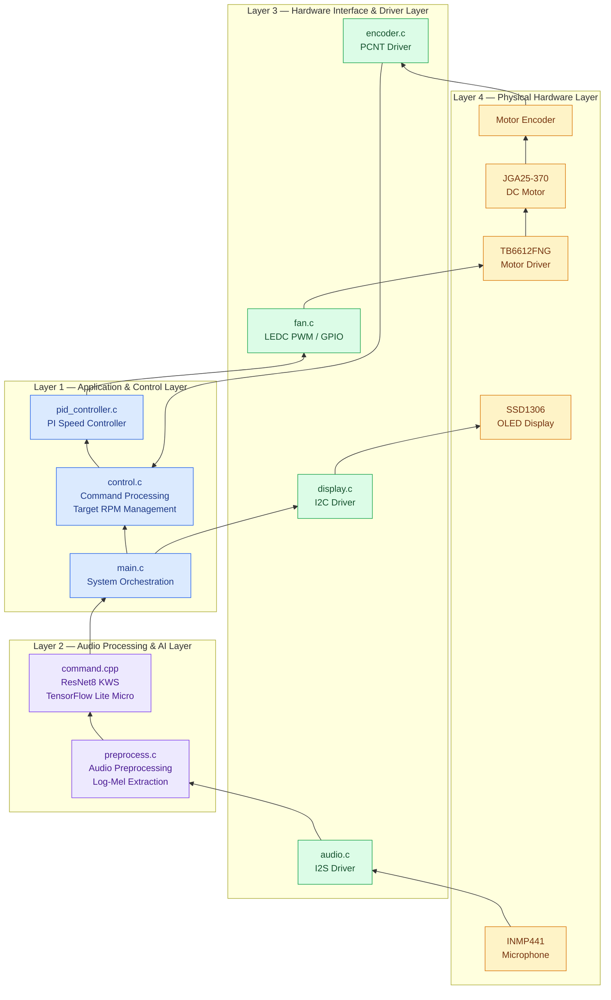

# Offline Voice-Controlled Fan

An embedded voice-controlled DC fan system powered by ESP32. The system recognizes voice commands locally using a quantized ResNet8 TinyML model and controls motor speed through closed-loop PI control.

The project integrates an INMP441 microphone, TensorFlow Lite Micro, a TB6612FNG motor driver, an encoder for RPM feedback, and an SSD1306 OLED display.

All voice recognition and motor control operations run locally on the ESP32 without requiring cloud services.

---

## 1. Project Overview

The main objectives are:

- Recognize predefined voice commands offline.
- Turn the fan on and off using voice commands.
- Select different motor speed levels.
- Measure motor speed using encoder feedback.
- Regulate motor speed using a PI controller.
- Display command status and power information on an OLED.
- Measure inference time and command response time.
- Develop and evaluate the TinyML model using Python.

## 2. System Architecture


### Layer Responsibilities

| Layer | Main responsibility |
|---|---|
| Layer 1 — Application & Control | Coordinates system operation, processes recognized commands, manages target RPM, and regulates motor speed. |
| Layer 2 — Audio Processing & AI | Converts microphone audio into Log-Mel features and performs voice command classification using ResNet8. |
| Layer 3 — Hardware Interface & Driver | Provides interfaces for I2S, PCNT, LEDC, GPIO, and I2C peripherals. |
| Layer 4 — Physical Hardware | Contains the microphone, motor driver, DC motor, encoder, and OLED display. |

### Data Flow

**Forward control flow:**

```text
Microphone
    ↓
Audio Acquisition
    ↓
Audio Preprocessing
    ↓
ResNet8 Inference
    ↓
Command Processing
    ↓
Target RPM
    ↓
PI Controller
    ↓
PWM Output
    ↓
DC Motor
```

**Feedback flow:**

```text
DC Motor
    ↓
Encoder
    ↓
RPM Measurement
    ↓
PI Controller
    ↓
PWM Adjustment
```

The feedback loop allows the system to continuously adjust motor speed based on the difference between target RPM and measured RPM.

The ESP32 acts as the main controller and hosts all firmware layers.

## 3. Voice Command Recognition

The system uses an 8-class ResNet8 classification model.

| Class | Function |
|---|---|
| `background` | Environmental background audio |
| `unknown` | Unrecognized voice command |
| `turn_on` | Turn on the motor |
| `turn_off` | Turn off the motor |
| `low` | Set low speed |
| `medium` | Set medium speed |
| `high` | Set high speed |
| `max` | Set maximum speed |

The `background` and `unknown` classes do not trigger motor control commands.

### Target Speed Configuration

The current firmware uses the following target RPM values:

| Voice Command | Target Speed |
|---|---:|
| `turn_off` | 0 RPM |
| `turn_on` | 80 RPM |
| `low` | 110 RPM |
| `medium` | 140 RPM |
| `high` | 170 RPM |
| `max` | 200 RPM |

The `turn_on` command starts the motor at 80 RPM. The other speed commands directly select their corresponding target RPM.

## 4. AI / TinyML Pipeline

The keyword spotting model uses ResNet8 and TensorFlow Lite Micro.

### Audio Configuration

| Parameter | Value |
|---|---:|
| Sample rate | 16,000 Hz |
| Audio window | 2 seconds |
| Window samples | 32,000 |
| FFT size | 512 |
| Frame length | 400 samples |
| Frame hop | 320 samples |
| Mel filterbank | 40 bands |
| Number of frames | 99 |
| Minimum frequency | 60 Hz |
| Maximum frequency | 7,600 Hz |

### Feature Extraction

The preprocessing pipeline consists of:

1. Audio windowing using a Hann window.
2. Short-Time Fourier Transform (STFT).
3. Power spectrum calculation.
4. Mel filterbank application.
5. Log-Mel feature extraction.
6. Mean normalization.
7. INT8 quantization.

The resulting feature tensor has the shape:

```text
[1, 99, 40, 1]
```

### Model Deployment

- Model architecture: ResNet8
- Framework: TensorFlow Lite Micro
- Input data type: INT8
- Output data type: INT8
- Number of output classes: 8
- Execution platform: ESP32

The model is embedded in the ESP32 firmware and performs inference locally.

## 5. Hardware

### Main Components

| Component | Description |
|---|---|
| ESP32 | Main microcontroller |
| INMP441 | I2S digital microphone |
| SSD1306 | 128 × 64 OLED display |
| TB6612FNG | Dual H-bridge motor driver |
| JGA25-370 | DC geared motor with encoder |
| Power supply | 9 V, 2 A |

The motor is rated at 12 V and 280 RPM. The current system operates with a 9 V supply.

### Hardware Interfaces

| Component | ESP32 Interface | Configuration |
|---|---|---|
| INMP441 BCLK | GPIO 26 | I2S |
| INMP441 WS | GPIO 25 | I2S |
| INMP441 SD | GPIO 34 | I2S |
| Encoder Channel A | GPIO 32 | PCNT |
| Encoder Channel B | GPIO 33 | PCNT |
| SSD1306 OLED | I2C | Display interface |
| TB6612FNG | GPIO / LEDC | Direction and PWM control |

## 6. Motor Control System

The motor is controlled using a TB6612FNG motor driver and an ESP32 LEDC PWM peripheral.

### Encoder Feedback

The encoder provides motor rotation feedback to the ESP32.

- Encoder interface: PCNT
- Channel A: Pulse counting
- Channel B: Rotation direction
- Decoding mode: x1
- Counts per revolution used in firmware: 228.5

The measured RPM is calculated from the encoder count difference and elapsed time.

### PI Controller

A PI controller regulates the motor speed by adjusting PWM duty based on the difference between target RPM and measured RPM.

Current control parameters:

| Parameter | Value |
|---|---:|
| Proportional gain (Kp) | 0.5 |
| Integral gain (Ki) | 3.0 |
| Derivative gain (Kd) | 0 |
| Sampling period | 100 ms |
| Maximum target RPM | 200 RPM |
| PWM maximum | 1000 |

The controller continuously reads encoder feedback and adjusts the PWM output to maintain the target motor speed.

## 7. OLED Display

The SSD1306 OLED provides visual feedback during system operation.

The display presents:

- Current command status.
- Motor power information.

The display is updated by the ESP32 firmware through the I2C interface.

## 8. Software Architecture

### ESP32 Firmware

The embedded firmware is developed using:

- ESP-IDF
- C and C++
- FreeRTOS
- TensorFlow Lite Micro
- I2S audio driver
- PCNT encoder driver
- LEDC PWM driver
- I2C communication

### Main Software Modules

| Module | Responsibility |
|---|---|
| `audio` | Microphone audio acquisition |
| `preprocess` | Audio preprocessing and Log-Mel extraction |
| `command` | ResNet8 inference and command classification |
| `control` | Motor command processing and PI control task |
| `pid_controller` | PI/PID calculation |
| `encoder` | Encoder counting and RPM measurement |
| `fan` | TB6612FNG and PWM motor control |
| `display` | SSD1306 OLED display handling |

### Python Development

Python is used for supporting AI development activities:

- Audio data collection and management.
- Dataset preprocessing.
- Feature extraction.
- Model training and evaluation.
- Model quantization.
- Visualization and performance analysis.

## 9. Performance Measurement

The firmware provides two timing measurements through the Serial Monitor.

### Inference Time

Measures the execution time of:

```cpp
interpreter->Invoke();
```

This measurement represents the model inference execution time only. Audio preprocessing and feature copying are excluded.

### Response Time

Measures the time from the beginning of audio preprocessing until the accepted command has completed its control execution.

It excludes:

- Microphone audio capture waiting time.
- Physical motor acceleration time.

These measurements help evaluate the computational performance and command processing latency of the embedded system.

## 10. Testing and Evaluation

The system is evaluated at different levels.

### Functional Testing

- Microphone audio acquisition.
- Audio preprocessing.
- ResNet8 inference.
- Voice command classification.
- Motor ON/OFF operation.
- Motor speed selection.
- Encoder RPM measurement.
- PI speed regulation.
- OLED status display.

### Performance Evaluation

Relevant measurements include:

- Voice command recognition accuracy.
- False recognition rate.
- Inference time.
- Response time.
- Target RPM versus measured RPM.
- Motor speed stability.
- System operating stability.

Quantitative test results should be added here after the corresponding experiments have been finalized.

---

## 11. Future Improvements

Potential improvements include:

- Expand the voice dataset with more speakers and environmental conditions.
- Improve recognition robustness under background noise.
- Optimize inference latency and memory usage.
- Evaluate motor speed tracking performance under different loads.
- Perform long-duration stability testing.
- Improve system power efficiency.
